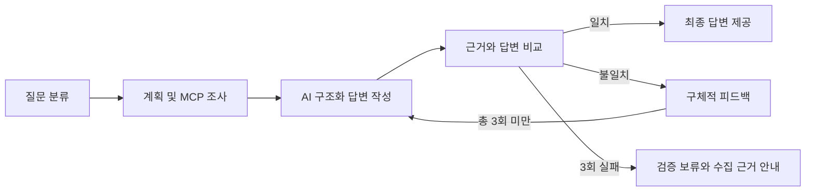

# skala-ai-mini-project

**모니터링 근거 대조를 통한 AI 장애 진단 답변 검증 개선**

SKALA AI 서비스 개발 미니프로젝트 · 2026년 10월 20일~22일

## 무엇을 개선했나요?

기존 Base AI Agent는 답변의 길이와 절차 번호를 검사했습니다. 이 프로젝트는 같은 요청에서 수집한 시스템 상태·CPU·메모리와 AI 답변을 비교합니다. 예를 들어 조회값이 CPU 78%인데 답변이 18%면 반려하고, 구체적인 오류를 알려준 뒤 다시 작성합니다. 총 3회 작성 후에도 실패하면 초안을 승인하지 않고 검증 보류로 안내합니다.

AI의 수치를 원본으로 덮어쓰지 않습니다. AI가 작성한 값을 유지한 채 비교하며, JSON을 화면에 표시하는 형식만 코드가 담당합니다. 원인 가설은 확정 진단과 구분해 안내합니다.

## 2일차 확인 결과 — 2026년 10월 21일

| 확인 항목 | 결과 |
|---|---|
| 단위·그래프 테스트 | 24개 통과 |
| 동일 합성 답변 23개 비교 | 오류·누락·형식 위반 17개 중 기존 1개, 개선 17개 탐지 |
| 정확한 합성 답변 6개 | 기존 6개 통과, 개선 5개 통과·자유형 1개 보류 |
| 실제 로컬 모델 통합 실행 | `qwen3.5:2b` 질문 6개 중 규칙 검증 6개 통과 |
| 실제 모델 평균 전체 처리 시간 | 9.47초 / 평균 작성 1.0회 |
| 외부 유료 AI API | 사용하지 않음 |

합성 사례는 직접 구성한 소규모 검증기 실험입니다. 실제 모델 결과도 샘플 모니터링을 사용한 단일 기기·설정의 통합 확인 결과입니다. 이 수치를 실제 운영 정확도나 환각 감소율로 해석하지 않습니다.

## 주요 기능

- 자연어로 특정 시스템의 장애·성능 문제 진단 요청
- MCP Tool로 샘플 모니터링 상태·CPU·메모리 조회
- MCP Resource로 대응 매뉴얼 조회
- 시스템별 상태·수치·근거 누락 검사
- 본문에 반복 인용된 CPU·메모리 수치도 시스템에 연결해 대조
- 오류 사유를 통한 재작성, 최대 작성 횟수 후 검증 보류
- 검증 전 진단 초안을 숨기고 진행 단계·검증 결과·최종 답변 표시
- 미등록 시스템은 다른 시스템으로 바꾸지 않고 미확인으로 조회·표시

## 실행하기

Python 3.11 이상, `uv`, Ollama가 필요합니다. 모델은 이 컴퓨터에 설치되어 있던 `qwen3.5:2b`로 확인했습니다. 아래 명령은 저장소 폴더에서 각각 실행합니다.

```bash
uv --no-cache venv .venv
uv --no-cache pip install --python .venv/bin/python -r requirements-lock.txt
```

Ollama가 아직 실행 중이 아니면 별도 터미널에서 실행합니다.

```bash
ollama serve
```

다른 컴퓨터에 모델이 없다면 `ollama pull qwen3.5:2b`로 먼저 준비합니다. 설치된 모델은 `ollama list`로 확인할 수 있습니다.

실제 로컬 AI 모델 실행:

```bash
.venv/bin/python sh/run_demo.py --backend ollama
```

브라우저에서 <http://127.0.0.1:8610> 접속. `Ctrl+C`로 이 실행이 시작한 서버만 종료합니다. 기존 프로세스나 대화 DB는 삭제하지 않습니다. 백엔드 8110, 화면 8610 포트를 사용합니다. 다른 모델은 `--model 모델이름`, 다른 포트는 `--backend-port`, `--frontend-port`로 지정합니다.

### 실제 모델 없이 흐름만 확인하기

```bash
.venv/bin/python sh/run_demo.py --backend fake
```

fake는 정해진 답변을 만들고 첫 초안의 CPU 값을 의도적으로 틀리게 작성합니다. 실제 모델 성능 평가가 아닙니다. 실제 모델 모드에는 이 오류 주입을 사용하지 않습니다.

## 처리 흐름



## 테스트와 비교 결과 재현

```bash
LANGCHAIN_TRACING_V2=false LANGSMITH_TRACING=false .venv/bin/python -m unittest discover -s tests -v
.venv/bin/python -m eval.run_eval
```

실제 모델 통합 평가는 Ollama를 실행한 상태에서 다음 명령으로 확인합니다. 로컬 모델을 동시에 사용하는 다른 요청이 없을 때 비교하는 것이 좋습니다.

```bash
LANGCHAIN_TRACING_V2=false LANGSMITH_TRACING=false .venv/bin/python -m eval.run_real_eval
```

첫 답변에 수치 오류를 한 번 넣어 실제 모델의 재작성을 확인하는 **별도 통제 실험**은 `python -m eval.rewrite_demo`입니다. 자연 생성 평가와 구분해 기록합니다.

## 문서 및 결과

- [1일차 선택 과제·진행 계획](docs/DAY1_PLAN.md)
- [2일차 구현·검증 보고](docs/DAY2_REPORT.md)
- [초보자를 위한 코드 읽는 순서](docs/CODE_GUIDE.md)
- [동일 합성 답변 Before/After 비교](reports/evaluation.md)
- [실제 모델 통합 실행 결과](reports/real_model_evaluation.md)
- [실제 모델 실행의 근거·초안 기록](reports/real_model_evaluation.json)

## 검증 범위와 한계

- 검증 통과는 지정된 시스템·상태·CPU·메모리와 필수 항목이 규칙을 만족했다는 뜻입니다. 원인·조치의 의미 전체를 검증하지 않습니다.
- 본문 수치는 식별 가능한 CPU·메모리 표현을 검사합니다. 모든 자연어·한글 수사·생략 표현을 이해하는 의미 검증기는 아닙니다. 대상 시스템이 모호하면 보류합니다.
- 원문에 확인되는 명시적 조건문의 임계값은 현재 측정값과 구분합니다. 매뉴얼 자체의 정확성은 이 검증의 범위 밖입니다.
- 정해진 항목이 없는 정확한 자유형 답변도 보류될 수 있습니다. 실모델에는 구조화 출력을 적용해 표기 차이로 인한 실패를 줄였습니다.
- 모니터링은 제공된 JSON 값에 무작위 변화를 더한 샘플입니다. 실제 서버 연결과 자동 복구 조치는 구현 범위에 포함하지 않습니다.
- 검증 완료 전 초안을 보내지 않아 진단 내용이 표시되기까지 기다려야 합니다. 재작성 시 모델 호출 시간도 증가합니다.
- 실행 스크립트는 LangSmith 전송을 기본 해제합니다. 이번 결과에서는 대시보드를 확인하지 않았습니다.
- OpenAI 작성 인터페이스에도 구조화 출력 처리를 적용했지만 실제 유료 API 호출은 검증하지 않았습니다.

## 구현 참고

기존 교육용 Base AI Agent의 FastAPI·LangGraph·MCP·SQLite 흐름을 활용했습니다. 이번 프로젝트의 중심 변경은 근거 검증, 구조화 출력 표시, 피드백 재작성과 보류, 초안 비노출, 테스트 및 비교 평가입니다.

로컬 생성은 Ollama의 [구조화 출력](https://docs.ollama.com/capabilities/structured-outputs)과 [Chat API](https://docs.ollama.com/api/chat)를 사용합니다. 답변의 항목 형식은 스키마로 정하고 수치 일치는 별도 코드로 검사합니다.
